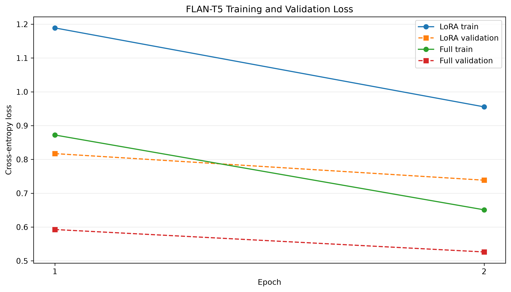
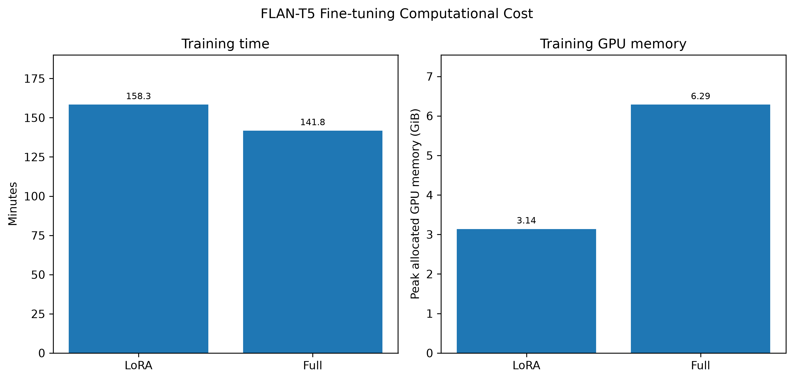
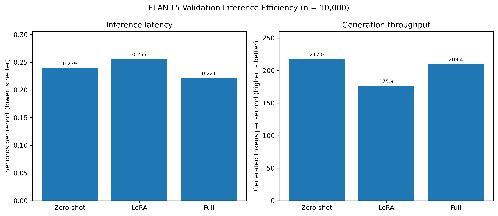

# Clinical Report Summarisation Using FLAN-T5

**COMP3710 Final Report — Hard Difficulty**  
**Project:** Layperson-friendly radiology report summarisation  
**Model:** FLAN-T5-base  
**Comparison:** Zero-shot, LoRA fine-tuning, and full fine-tuning

> **Scope of this document:** Sections 1–2 and 4–12 describe the implementation, results, source-grounded case study and limitations. Section 3 is intentionally reserved for the author’s previously approved one-page Feasibility Review. This report is a research prototype evaluation.

## 1. Introduction

Clinical radiology reports often contain specialised terminology that is difficult for non-specialists to interpret. Generating plain-language summaries could improve accessibility, but incorrect paraphrases may omit important findings, invent medical details, or change the certainty of a diagnosis. These risks are especially important when summaries may be read by patients.

This project investigates whether adapting **FLAN-T5-base** improves layperson-friendly radiology report summarisation. Three settings are compared: the pretrained model without task-specific fine-tuning (**zero-shot**), parameter-efficient **Low-Rank Adaptation (LoRA)**, and **full fine-tuning**. The comparison considers both text-overlap quality (ROUGE) and computational resources, followed by an examination of clinical factual consistency in real model outputs.

The engineering question is: **Can a model achieve strong summarisation performance without introducing clinically meaningful misinformation, and is the additional computational expense of full fine-tuning justified relative to LoRA?**


## 2. Background and Related Work

### 2.1 Radiology report simplification and factuality

ROUGE measures lexical overlap between generated and reference summaries. It is useful for quantitative benchmarking but does not directly test whether a generated sentence preserves a clinical finding or its diagnostic certainty. Zhang et al. (2020) investigated factual correctness in radiology summarisation and showed the importance of evaluating factual consistency independently of surface text overlap [1]. Trienes et al. (2023) studied errors in radiology report summarisation, including omitted information and unsupported content [2].

Jeblick et al. (2024) evaluated simplified radiology reports and identified examples involving incorrect statements, missed relevant medical information, and potentially harmful wording [3]. Asgari et al. (2025) proposed a structured framework for categorising hallucinations, omissions, and possible clinical consequences in medical text generation [4]. These findings motivate the source-grounded safety audit in Section 8.

### 2.2 FLAN-T5 and parameter-efficient fine-tuning

T5 is an encoder–decoder Transformer that maps input text to output text [5]. FLAN-T5 builds on instruction fine-tuning, making the model suitable for tasks expressed as natural-language prompts [6]. LoRA freezes pretrained weights and trains smaller low-rank adaptation matrices instead of updating the complete model [7]. This can reduce trainable parameter count and GPU memory requirements, but lower training cost or higher factual accuracy must be verified for each implementation.

A BioLaySumm 2025 system paper by Zhang et al. investigated T5-based approaches to lay summarisation of radiology reports, supporting the relevance of encoder–decoder modelling for this task [8]. That publication is contextual literature, **not** evidence that LoRA must outperform full fine-tuning in this project.

## 3. Feasibility Review

1. User Need, Scope and Acceptance Criteria: Radiology reports often contain medical terms that are difficult for patients to understand. This project aims to use FLAN-T5 to rewrite these reports in simpler language while keeping the important medical information correct. The goal is to help patients understand their reports more easily, rather than replace medical advice from doctors.I will evaluate the model using ROUGE-1, ROUGE-2, ROUGE-L and ROUGE-Lsum, and compare the results with a zero-shot baseline. I will also examine 3–5 real test cases to check whether the model adds incorrect information, misses important findings, or uses language that is still too difficult for patients. To check whether the model is practical, I will measure GPU memory usage, training time and inference speed.
2. Model Choice and Course Concepts: I chose the BioLaySumm2025 LaymanRRG dataset because it contains radiology reports and their patient-friendly summaries. I use FLAN-T5-Base, which is a Transformer model designed for text generation and instruction-based tasks. This project is classified as Hard Difficulty in the assignment specification.I compare three approaches: zero-shot FLAN-T5, LoRA fine-tuning and full fine-tuning. Zero-shot provides a baseline without extra training. LoRA trains a small number of additional parameters while keeping most of the original model unchanged. Full fine-tuning updates all model parameters. This project applies course concepts such as attention, transfer learning, tokenisation, cross-entropy loss and model evaluation. Comparing these approaches will help me understand the balance between model performance and computational cost.
3. Preliminary Feasibility Evidence: I have implemented the data loading, model training and evaluation code using PyTorch and Hugging Face. I also used the UQ Rangpur GPU server to test whether the models could run within the available computing resources. The experiments show that fine-tuning improves the ROUGE scores compared with the zero-shot baseline. ROUGE-1 increased from 0.2195 for zero-shot to 0.7140 for LoRA and 0.7415 for full fine-tuning. All three models were evaluated on the same 10,000 validation reports. LoRA training used about 3.14 GiB of peak GPU memory, while full fine-tuning used about 6.29 GiB. Both models completed two training epochs successfully. These results suggest that the project is practical with the available GPU resources. However, higher ROUGE scores do not necessarily mean that the generated summaries are medically accurate.
4. Risks, Budget and Fallback: The main risk is that the model may produce summaries that sound correct but contain medical errors. For example, it might add findings that are not in the original report, leave out important information, or change the meaning of medical terms. Long reports may also be shortened during tokenisation, which could remove useful details.
Another concern is computing cost. Full fine-tuning needs more GPU memory and model storage, while LoRA is more memory-efficient. Both approaches can run on the available Rangpur GPU resources, but their performance and safety still need to be compared carefully. My next step is to examine 3–5 test cases and compare the original reports, reference summaries and model predictions. If full fine-tuning requires too many resources or produces unsafe summaries, LoRA can be used as an alternative. Any summary containing uncertain or incorrect medical information should be reviewed by a healthcare professional before being shown to patients.
Overall, the project is technically feasible, but further clinical safety analysis is needed before considering real-world use.

## 4. Dataset and Preprocessing

### 4.1 Data source, input fields and tokenisation

Experiments use the BioLaySumm 2025 LaymanRRG open-source radiology-report summarisation dataset, accessed through Hugging Face Datasets as `BioLaySumm/BioLaySumm2025-LaymanRRG-opensource-track`. The model is `google/flan-t5-base`. The loader (`dataset.py`) uses the dataset provider's existing `train`, `validation` and `test` partitions rather than performing a new random split.

| Partition | Examples | Usage |
|---|---:|---|
| Train | 150,454 | Gradient-based fine-tuning |
| Validation | 10,000 | Checkpoint selection and reference-based ROUGE benchmarking |
| Test | 10,537 | Source of a 100-case qualitative error-audit subset |

The input field is `radiology_report` and the supervised target field is `layman_report`. Every input is prefixed with the same instruction:

> Rewrite this radiology report in simple, accurate, patient-friendly language without adding new findings:

The training pipeline tokenises inputs with a maximum **256-token source length** and targets with a maximum **128-token target length** (`truncation=True`). The `DataCollatorForSeq2Seq` applies dynamic padding and uses the ignore index `-100` for padded target positions. These positions are excluded from the supervised cross-entropy loss. The fixed 256-token input cap may omit late findings from long source reports and is therefore a clinically relevant limitation, particularly for Test Case 1.

### 4.2 Exact-Text Overlap Audit

This project adopted the **official train, validation, and test splits** from the beginning, without additional random partitioning. A subsequent audit compared source texts across splits using `strip()` and `casefold()` normalisation, with identical input–target pairs checked separately.

| Audit measure | Observed count |
|---|---:|
| Validation records sharing an input with training | **4,506 / 10,000 (45.06%)** |
| Of these, records also sharing the reference summary | **2,380** |
| Validation records without exact training-input matches | **5,494 / 10,000 (54.94%)** |
| Distinct matching texts: train–validation | **2,150** |
| Distinct matching texts: train–test | **3** |
| Distinct matching texts: validation–test | **1** |

The first three measures count validation records, while the last three count distinct matching texts. These are **text-level matches**, not confirmed patient-level leakage. Exact matching also cannot detect semantic duplicates.

**Evaluation implications.** Since 45.06% of validation records share exact inputs with training, the original validation scores may overestimate generalisation to unseen texts. Checkpoints were also selected using this validation split. Section 7.5 therefore provides a **post-hoc overlap-aware evaluation** using existing predictions, without retraining. 

### 4.3 Availability of test references

A first-100-example export of the official test split was used for qualitative clinical error analysis. In this exported subset, **all 100 `reference_summary` fields were empty**. Accordingly, the audit compares model outputs with their **original source reports** and does not claim valid test-set ROUGE. Quantitative ROUGE in Section 7 is calculated from the **10,000 validation examples**, where reference summaries were present.

## 5. Methodology

### 5.1 FLAN-T5 Architecture

The model is instantiated using `AutoModelForSeq2SeqLM` from Hugging Face Transformers. An encoder represents the prompted radiology report, while a decoder generates a layperson-oriented summary autoregressively. The model components and checkpoint-loading functions are implemented in `modules.py`.

### 5.2 Zero-shot Baseline

The zero-shot baseline uses the pretrained FLAN-T5-base weights without task-specific updates. It receives the same summarisation prompt as the fine-tuned models. This provides a baseline against which the value of task adaptation can be measured.

### 5.3 LoRA Fine-tuning

LoRA inserts trainable low-rank matrices into the attention projections while leaving the base model frozen. The implementation uses:

| Hyperparameter | Value |
|---|---|
| Rank (`r`) | 8 |
| LoRA alpha | 16 |
| LoRA dropout | 0.05 |
| Target modules | `q`, `v` |
| Learning rate | `2e-4` (default in training script) |
| Epochs | 2 |
| Per-device batch size | 4 |
| Gradient accumulation | 4 |

The resulting adapter is saved under `outputs/lora/best`.

### 5.4 Full Fine-tuning

Full fine-tuning updates the trainable parameters of the pretrained FLAN-T5-base model rather than restricting updates to low-rank adapters. The implementation uses the same number of epochs, batch size, and gradient accumulation as LoRA, but a different default learning rate (`3e-5`). Its selected checkpoint is saved under `outputs/full/best`.

Because the learning rates differ, the comparison is between the **implemented training configurations**, not an isolated controlled intervention where adaptation strategy is the only differing factor.

## 6. Experimental Setup

The training scripts use a single CUDA GPU under the Rangpur Slurm environment. Both fine-tuning modes use `AdamW`, two epochs, batch size 4, gradient accumulation 4, and seed 42. The training script stores the checkpoint with the lowest recorded validation loss.

Validation generation is handled by `predict.py` and `evaluate_utils.py`, with `max_new_tokens=128`, `num_beams=1`, and inference batch size 8 in the evaluation shell scripts. Generation runs in `torch.inference_mode()`.

| Setting | Zero-shot | LoRA | Full |
|---|---|---|---|
| Base model | FLAN-T5-base | FLAN-T5-base | FLAN-T5-base |
| Trainable adaptation | None | Attention adapters | Full model |
| Training epochs | — | 2 | 2 |
| Training learning rate | — | `2e-4` | `3e-5` |
| Batch size / grad accumulation | — | 4 / 4 | 4 / 4 |
| Input/output token limits | 256 / 128 | 256 / 128 | 256 / 128 |
| Generation beams | 1 | 1 | 1 |
| Random seed | — (no training) | 42 | 42 |
| Total parameters (training profile) | — | 248,462,592 | 247,577,856 |
| Trainable parameters (training profile) | 0 (frozen inference baseline) | 884,736 | 247,577,856 |
| Trainable share of total parameters | 0% | 0.3561% | 100% |

The parameter counts, training durations and peak allocated CUDA memory values are copied from the actual `outputs/lora/train_profile.json` and `outputs/full/train_profile.json`. The LoRA total includes its added adapter weights, which explains why its total parameter count is slightly larger than the full model. With one GPU, the nominal effective training batch size is `4 × 4 = 16` examples per optimizer step (except a possible final partial accumulation step). Since the training profile records `lr: null`, the learning rates shown above are the mode-specific defaults in `train.py`: `2e-4` for LoRA and `3e-5` for Full.

### 6.1 Verified software environment

The reported Rangpur Conda environment is named `flan-t5` and uses **Python 3.11**. Versions were read directly from the active environment during the project:

| Dependency | Installed version |
|---|---|
| PyTorch | `2.13.0+cu130` |
| Transformers | `5.19.0` |
| Datasets | `5.1.0` |
| PEFT | `0.21.2` |
| Accelerate | `1.15.0` |
| Evaluate | `0.4.6` |
| rouge-score | `0.1.2` |
| SentencePiece | `0.2.2` |
| Matplotlib | `3.11.1` |

These versions are reproduced in the recommended `requirements.txt`. The public PyTorch requirement `torch==2.13.0` identifies the base release; reproducing the exact Rangpur `+cu130` build additionally requires a CUDA-compatible installation. **The GPU model was not captured in the supplied training profiles**, so timing results should be interpreted as measurements from these particular Rangpur runs rather than hardware-independent comparisons.

## 7. Results and Analysis

> The four figure assets are referenced from `results/figures/` relative to this README. The values in the tables were checked against the experiment outputs supplied from Rangpur. Copy the four images into that directory when integrating this document into the repository.

### 7.1 ROUGE Comparison


**Figure 1.** ROUGE scores measured on the **same held-out 10,000-example validation split** for all three settings; numbers in the table are taken from the saved `metrics.json` files.

| Metric | Zero-shot | LoRA | Full |
|---|---:|---:|---:|
| ROUGE-1 | 0.219534 | 0.714035 | **0.741504** |
| ROUGE-2 | 0.069288 | 0.524513 | **0.566291** |
| ROUGE-L | 0.185507 | 0.660890 | **0.693441** |
| ROUGE-Lsum | 0.185560 | 0.661002 | **0.693336** |
| Evaluation examples | 10,000 | 10,000 | 10,000 |

Both adapted models substantially exceed the zero-shot baseline on lexical-overlap metrics. Full fine-tuning has the highest ROUGE in all four measurements, but these metrics alone cannot establish clinical factual reliability [1, 2].

### 7.2 Training and Validation Loss



**Figure 2.** Loss curves for LoRA and full fine-tuning. **Interpretation caution:** The `train_loss` in `train.py` is the mean of batch losses collected **while parameters are updated throughout each epoch** in `model.train()` mode. In contrast, `validation_loss` is measured **after each epoch** using the updated model in `model.eval()` mode. They are not losses computed at the same fixed checkpoint or under the same dropout conditions; direct magnitude comparisons must therefore be treated cautiously.

Both training and validation loss decrease over the two epochs. The higher online training loss is compatible with these measurement differences, but the cause of the gap has **not yet been experimentally isolated**. A stronger check would recompute both train and validation loss using the same saved checkpoint in evaluation mode. Dataset size alone does not explain a difference in mean loss.

### 7.3 Computational Cost



**Figure 3.** Training duration and peak allocated GPU memory for the fine-tuning runs.

| Metric | LoRA | Full |
|---|---:|---:|
| Training duration | 158.33 min (9,500.08 s) | **141.75 min (8,505.22 s)** |
| Peak allocated GPU memory | **3.140 GiB** | 6.286 GiB |
| Total parameters | 248,462,592 | 247,577,856 |
| Trainable parameters | **884,736** | 247,577,856 |
| Trainable parameter ratio | **0.3561%** | 100% |

Relative to full fine-tuning, LoRA trains approximately **99.64% fewer parameters** and reduces peak allocated training GPU memory by **50.05%** (3.140 versus 6.286 GiB). Nevertheless, LoRA took **16.58 minutes longer** (11.70% more elapsed time) in the recorded runs. This supports LoRA's **parameter efficiency and reduced allocated GPU memory**, but not a claim of faster end-to-end training in this configuration. These figures come from `train_profile.json`; `train_seconds` includes the training-loop and validation work timed in `train.py`, and `peak_gpu_gb` is **PyTorch peak allocated CUDA memory**, not total memory reserved by the process or physical GPU utilisation. Single-run timings may depend on runtime conditions and are not a hardware-independent benchmark.

### 7.4 Inference Efficiency



**Figure 4.** Inference metrics measured during validation generation of **10,000 reports per model**, with batch size 8, source maximum length 256, generation maximum 128 tokens, and greedy decoding (`num_beams=1`). The reported token throughput is aggregate generated tokens per wall-clock second under the script's counting convention; it is not necessarily normalized for output length.

| Metric | Zero-shot | LoRA | Full |
|---|---:|---:|---:|
| Total validation inference time | 2,389.62 s | 2,550.82 s | **2,210.11 s** |
| Seconds per report | 0.238962 | 0.255082 | **0.221011** |
| Generated tokens/s | **216.996** | 175.802 | 209.378 |
| Peak allocated inference GPU memory | 1.154458 GiB | 1.157868 GiB | 1.154458 GiB |
| Evaluated reports | 10,000 | 10,000 | 10,000 |

Full fine-tuning gives the lowest observed latency per report, while zero-shot gives the highest aggregate generated-token throughput in these recorded runs. These are **different metrics**, so their rankings need not match. All three variants have similar measured PyTorch peak *allocated* inference GPU memory, around 1.15 GiB. LoRA was not the fastest inference configuration. Inference comparisons can be affected by generated sequence lengths, hardware and measurement conditions, so the results should not be generalised beyond the current setup.

**Important note on parameter counts:** `evaluate_utils.py` records the number of parameters with `requires_grad=True` at inference time. In the LoRA evaluation run, adapters are loaded for inference with no trainable parameters (`trainable_params=0` in `eval_lora_validation/metrics.json`), whereas the Full model is loaded with its parameter flags enabled. These *inference-time flags* must **not** be used as evidence for which parameters were updated during training. The actual training-time counts come from the training profiles (Section 7.3).

### 7.5 Overlap-Aware Validation Evaluation

As described in Section 4.2, this project adopted the official training, validation, and test splits provided by the dataset from the beginning of implementation, without performing additional random partitioning. A subsequent exact source-text overlap audit identified 4,506 validation records whose normalised input texts also appeared in the training split. To investigate the potential influence of this overlap on the reported evaluation results, we conducted an additional overlap-aware analysis.

The original 10,000 validation records were divided into two subsets:

- **Clean-input subset (n = 5,494):** Validation records with no exact normalised source-text match in the training split.
- **Overlapping-input subset (n = 4,506):** Validation records whose normalised source texts exactly matched at least one training record.

Existing `predictions.jsonl` files from all three configurations (Zero-shot, LoRA, and Full Fine-tuning) were aligned with the original validation order and evaluated separately on these subsets. **No additional model training, checkpoint selection, or text generation was performed.** The analysis therefore provides a retrospective comparison using previously generated predictions.

**Table 7.5a. ROUGE scores on the clean-input validation subset (n = 5,494).**

| Metric | Zero-shot | LoRA | Full |
|---|---:|---:|---:|
| ROUGE-1 | 0.262383 | 0.671787 | **0.706149** |
| ROUGE-2 | 0.089439 | 0.453032 | **0.505021** |
| ROUGE-L | 0.218351 | 0.601730 | **0.643170** |
| ROUGE-Lsum | 0.218456 | 0.601718 | **0.643084** |

**Table 7.5b. ROUGE scores on the overlapping-input validation subset (n = 4,506).**

| Metric | Zero-shot | LoRA | Full |
|---|---:|---:|---:|
| ROUGE-1 | 0.167324 | 0.765643 | **0.784723** |
| ROUGE-2 | 0.044799 | 0.611630 | **0.640842** |
| ROUGE-L | 0.145238 | 0.733167 | **0.754508** |
| ROUGE-Lsum | 0.145286 | 0.733237 | **0.754644** |

Both fine-tuned configurations achieved substantially higher ROUGE scores on overlapping-input records than on clean-input records. For **LoRA**, ROUGE-L increased from 0.6017 on the clean subset to 0.7332 on the overlapping subset, an absolute difference of **0.1314**. For **Full Fine-tuning**, the corresponding scores were 0.6432 and 0.7545, an absolute difference of **0.1113**.

Compared with the original aggregate validation scores reported in Section 7.1, the clean-input ROUGE-L scores were lower for both fine-tuned models: LoRA decreased from **0.6609 to 0.6017**, while Full Fine-tuning decreased from **0.6934 to 0.6432**. Nevertheless, Full Fine-tuning continued to outperform LoRA across all four ROUGE metrics on the clean-input subset, indicating that their relative performance ranking was maintained after excluding exact input overlaps from evaluation.

In contrast, **Zero-shot performed better on the clean-input subset** (ROUGE-L = 0.2184) than on the overlapping-input subset (ROUGE-L = 0.1452). This opposing pattern suggests that the performance differences cannot be attributed solely to exact source-text overlap. Other characteristics, such as report complexity, document length, reference-summary length, and writing style, may also contribute to the observed variation between subsets.

Overall, the results suggest that **the original aggregate validation scores may present an optimistic estimate of performance on previously unseen source texts**, particularly for the fine-tuned configurations. However, the analysis does not establish that the observed differences are caused by memorisation, since the two subsets may differ in characteristics beyond input overlap.

**Limitations.** The clean-input subset excludes only exact matches of normalised source text and does not guarantee the absence of near-duplicates, semantically similar reports, or shared underlying study content. Furthermore, model checkpoints were selected using the original validation split, which contained overlapping records. Consequently, this retrospective analysis should be interpreted as a **sensitivity analysis rather than a fully leakage-free evaluation**. A more rigorous future experiment would identify and group overlapping or closely related records before training, use independent validation data for checkpoint selection, and evaluate the final models on a genuinely held-out test set.

## 8. Clinical Safety and Error Analysis

### 8.1 Evaluation Procedure and Error Categories

The safety audit uses the **first 100 examples of the official test split**, evaluated with identical source/output token limits and the same three model variants. An initial comparison file aligns each example's original radiology report with the zero-shot, LoRA, and full fine-tuning outputs.

Five cases were **purposively selected** because they show distinct and interpretable failure modes. Generated text was compared with the **original radiology report** rather than an unavailable reference summary. This is a preliminary **source-grounded qualitative error audit**, not a blinded clinician assessment or a statistically representative error-rate study. The potential harms noted below are analytical risk scenarios, not documented patient outcomes.

The principal categories were:

- **Hallucination / unsupported addition:** an asserted clinical detail that is not supported by the source.
- **Critical information omission or truncation:** loss of a relevant clinical finding or recommendation.
- **Diagnostic polarity or certainty change:** reversing negation or changing an uncertain conclusion into a more definitive statement (or vice versa).
- **Medical terminology misinterpretation:** changing the meaning of a clinical term during simplification.
- **Readability/contextual misunderstanding:** producing confusing, repetitive or semantically inappropriate patient-facing language.

The taxonomy is informed by prior work on factual radiology summarisation and medical text safety [1–4].

### 8.2 Case 1 — Diagnostic Polarity Reversal (Test Case 100)

**Source evidence.** The report describes new bilateral lower-lung opacities and states that these findings are **“atypical for COVID-19 pathology”** given the clear costophrenic angles.

| Model | Relevant output and observation |
|---|---|
| Zero-shot | Includes “atypical for COVID-19 pathology”, but is highly compressed and omits some of the report context. |
| LoRA | Says the findings are **“typical for COVID-19”**, reversing the original diagnostic interpretation. |
| Full | Says the findings are **“not typical for COVID-19”**, preserving the relevant distinction. |

**Classification:** Diagnostic polarity reversal / factual inconsistency in the LoRA output.

**Potential risk:** A patient could interpret the radiographic appearance as more characteristic of COVID-19 than the source report actually states. This is a diagnostic interpretation error, not evidence that the model issued a definitive clinical diagnosis.

**Engineering response:** Validate clinical polarity and certainty expressions (`atypical`, `typical`, `no evidence of`, `possible`, `likely`, `cannot exclude`) against the source. Flag mismatches for review.

### 8.3 Case 2 — Medical Terminology Misinterpretation (Test Case 53)

**Source evidence.** The report recommends clinical follow-up for **hemoptysis** (coughing up blood) and a complete thoracic CT scan.

| Model | Relevant output and observation |
|---|---|
| Zero-shot | Produces an unsupported description of “acute pulmonary hemoptysis” as a complication of a pulmonary artery condition. |
| LoRA | Recommends follow-up for a **“blood clot”**, which is not equivalent to hemoptysis. |
| Full | Correctly expresses the symptom as **“coughing up blood”**. |

**Classification:** Medical terminology misinterpretation in LoRA; unsupported clinical elaboration in zero-shot.

**Potential risk:** The incorrect term could cause a patient to misunderstand the reason for follow-up.

**Engineering response:** Use a verified terminology mapping for high-risk clinical concepts and check that the simplified expression refers to the same symptom or condition as the source [3].

### 8.4 Case 3 — Unsupported Clinical Detail (Test Case 83)

**Source evidence.** The report concerns pneumonia follow-up, improvement in left lower-lobe consolidation, and **“dorsolumbar instrumentation”**.

| Model | Relevant output and observation |
|---|---|
| Zero-shot | Generates unrelated repetitive text and fails to communicate the clinical findings. |
| LoRA | Describes a surgical device in the lower back area; the description is simplified and imprecise but does not assign a specific function to it. |
| Full | States that the device is **“to help with breathing”**, a purpose not supported by the report. |

**Classification:** Unsupported addition / hallucinated device purpose in the Full output.

**Potential risk:** Assigning an invented purpose to an implanted or surgical device can mislead a reader about the patient's history.

**Engineering response:** Check factual relations, not just entity presence: a device may be mentioned correctly while the model invents its function. This case shows that the model with the higher overall ROUGE can still make an individual factual error [1, 2].

### 8.5 Case 4 — Incomplete Clinical Conclusion (Test Case 1)

**Source evidence.** The original report is unusually long and contains repeated text. Its conclusion reports **radiological worsening with new consolidation in the left lower lobe**.

| Model | Relevant output and observation |
|---|---|
| Zero-shot | Gives only a generic description of pulmonary opacities and omits the worsening/new-consolidation conclusion. |
| LoRA | Ends abruptly with **“Conclusion: The x-ray shows worsen”** and does not complete the important new-consolidation finding. |
| Full | Preserves the worsening and **new consolidation in the left lower lung**. |

**Classification:** Information omission / incomplete generation, particularly in the LoRA output.

**Potential risk:** The user may miss a change from the previous imaging examination that could be important for follow-up.

**Engineering response:** Audit long-source truncation and generated-output completion. The configured limit is `max_new_tokens=128`, but the available output alone does **not** prove that this limit caused the truncation; the generated token count and stopping condition should be checked before assigning a mechanism.

### 8.6 Case 5 — Severe Baseline Hallucination and Contextual Error (Test Case 7)

**Source evidence.** The consultation aims to rule out an **acute neonatal condition**. The chest image shows **no radiological abnormalities**.

| Model | Relevant output and observation |
|---|---|
| Zero-shot | Invents **“acute pulmonary fibrosis”** and repeatedly asserts an unsupported lung condition. |
| LoRA | Misinterprets the neonatal context as **“a sudden pregnancy”**, although it retains the absence of chest abnormalities. |
| Full | Correctly explains that the examination was checking for an urgent condition in a newborn and that the chest image showed no problems. |

**Classification:** Severe unsupported pathology and repetition in zero-shot; contextual/medical semantic error in LoRA.

**Potential risk:** Fabricated conditions or confusion about who is being examined undermine patient understanding, especially where a normal result should provide reassurance.

**Engineering response:** Implement source-based checks for the presence or absence of conditions, patient context and unsupported disease mentions; flag unexplained repetition [3, 4].

### 8.7 Cross-Case Findings and Limitations

| Test case | Main issue | Clearest example |
|---|---|---|
| 100 | Diagnostic polarity reversal | LoRA: `atypical` → `typical` |
| 53 | Wrong medical concept | LoRA: `hemoptysis` → `blood clot` |
| 83 | Unsupported addition | Full: device “to help with breathing” |
| 1 | Missing/incomplete conclusion | LoRA output ends before new consolidation is explained |
| 7 | Invented disease / contextual misunderstanding | Zero-shot: pulmonary fibrosis; LoRA: pregnancy |

The selected examples show that **both fine-tuning methods have plausible-sounding yet inaccurate outputs**, while zero-shot has severe failures in several examples. Full fine-tuning appears more faithful for several **selected** cases, but one of the selected cases shows an unsupported addition from Full. These observations cannot establish overall clinical superiority, because the cases were selected for interpretability rather than randomly sampled and have not undergone blinded expert scoring.

The test CSV contains no reference summaries for these 100 cases; consequently, no valid test-set ROUGE is reported. Readability is assessed descriptively, not as a measured sixth-grade readability score. Where clinical risk severity is disputed, review by a qualified clinician would be required.

## 9. Discussion and Engineering Recommendation

### 9.1 Main findings and performance–cost trade-off

The project compares lexical summarisation performance, the efficiency of adapting FLAN-T5-base, and potential clinical factual errors. The evidence supports the following conclusions.

- **Task adaptation matters:** On the original 10,000-example validation split, LoRA and Full achieve much higher ROUGE than the zero-shot baseline. Nevertheless, ROUGE alone cannot validate the clinical meaning of a summary [1–4].
- **Full has the higher observed ROUGE:** It leads LoRA on every ROUGE metric on both the original validation set and the 5,494-example clean-input subset. This remains true after the overlap-aware sensitivity analysis.
- **LoRA's measured advantage is training-memory efficiency:** It trains **884,736 parameters (0.3561% of its total)**, compared with 247,577,856 for Full, and reduces peak allocated training CUDA memory by **50.05%**. It is **not faster** in the recorded end-to-end training run (158.33 vs 141.75 min), nor in validation inference latency (0.2551 vs 0.2210 s/report). Different learning rates and possible runtime effects further limit attributing differences solely to adaptation strategy.
- **Official validation independence is limited:** **4,506/10,000 (45.06%)** validation records share exact source report text with training records, including **2,380** whose reference summary also matches. Both fine-tuned models obtain substantially higher ROUGE on that overlapping subset. The clean-input analysis is more conservative but remains post-hoc and not patient-audited.
- **Both fine-tuning methods exhibit clinically relevant mistakes in selected examples:** LoRA reverses diagnostic polarity in Test Case 100 and changes *hemoptysis* to *blood clot* in Test Case 53; Full invents a purpose for spinal instrumentation in Test Case 83. Zero-shot displays severe unsupported pathology in Test Case 7. These are **illustrative cases, not estimated clinical error rates**.

The practical engineering dilemma therefore cannot be resolved by ranking ROUGE values alone. Full provides higher lexical overlap in the measured experiments, while LoRA may be preferable if **training GPU memory is the dominant constraint**, provided that factual safety is separately evaluated. Neither method is demonstrated safe for autonomous patient-facing use.

### 9.2 Risk controls and recommended workflow

1. **Input/data checks:** Where available, group records by patient before splitting and verify train/validation/test independence. Remove or explicitly handle exact and near-duplicate reports before new model training and validation-based checkpoint selection.
2. **Clinical-entity checks:** Compare mentioned symptoms, abnormalities, anatomical locations, procedures and devices against the original report. Detect additions of unsupported relations, such as an invented device purpose.
3. **Polarity and certainty checks:** Flag reversals of `no evidence of`, `typical/atypical`, `suspected`, `possible`, `likely`, and `cannot rule out`, particularly when the change affects diagnosis or follow-up.
4. **Completeness checks:** Test important negatives, new/worsening findings and follow-up recommendations for omissions. Inspect generation stop reasons and truncation rates given the 256-token source and 128-token output limits.
5. **Human-in-the-loop review:** Route uncertain, contradictory, or incomplete summaries to qualified healthcare professionals. This prototype should not generate definitive medical advice or deliver summaries to patients without oversight.
6. **Prospective evaluation:** Evaluate on patient-independent records with prespecified clinical error categories, multiple expert raters where feasible, readability measures, and resource profiling on repeat runs. Measure train- and validation-set loss at the *same fixed checkpoint in evaluation mode* if comparing their magnitudes.

### 9.3 Decision and limitations

**Recommendation to the project manager:** Retain **LoRA as a memory-efficient research candidate**, and **Full fine-tuning as the higher-ROUGE benchmark**. Do **not** advance either to unattended patient-facing deployment based on these results. Future progression should be conditional on genuinely independent clinical validation, evidence of low-severity and low-frequency factual errors, and a documented procedure for expert review of flagged outputs.

Limitations include the non-independent official validation source texts; lack of established patient-level separation; unequal default learning rates across adaptation methods; only one measured training run per configuration; training and validation losses computed under nonidentical conditions; unmeasured human-readable grade level; qualitative rather than clinician-blinded safety review; and no reference summaries in the exported first 100 test cases. These limitations constrain causal claims and clinical generalisability.

## 10. Installation and Usage

### 10.1 Repository structure

Place the implementation in the course repository under `recognition/FLAN_T5_s4985289/` on the `topic-recognition` branch. Mandatory modular files are `modules.py`, `dataset.py`, `train.py`, `predict.py` and `README.md`; helper and Slurm scripts can coexist with them.

```text
recognition/FLAN_T5_s4985289/
|   analyse_errors.py
|   baseline.py
|   dataset.py
|   evaluate_utils.py
|   merge_clinical.py
|   modules.py
|   plot_results.py
|   predict.py
|   README.md
|   requirements.txt
|   train.py
|   train_full.sh
|   
+---results
|   |   clinical_comparison.csv
|   |   
|   +---eval_full_validation
|   |       metrics.json
|   |       predictions.jsonl
|   |       
|   +---eval_lora_validation
|   |       metrics.json
|   |       predictions.jsonl
|   |       
|   +---eval_zero_validation
|   |       metrics.json
|   |       predictions.jsonl
|   |       
|   +---figures
|   |       01_rouge_comparison.png
|   |       02_loss_comparison.png
|   |       03_training_cost.png
|   |       04_inference_efficiency.png
|   |       
|   +---full
|   |       history.json
|   |       loss_curve.png
|   |       train_profile.json
|   |       
|   \---lora
|           history.json
|           loss_curve.png
|           train_profile.json
|           
\---Slurm
        eval_clinical.sh
        eval_full.sh
        eval_lora.sh
        eval_zero.sh
        job.sh
```

**Additional audit scripts used during analysis:** `eval_clinical.sh`, `merge_clinical.py`, `audit_overlap.py` and `evaluate_clean.py`. These were run separately during the analysis and should be included in the source repository if their exact execution paths are to be reproduced; they are not assumed to be present in the basic file tree above. Large datasets, prediction exports and model checkpoints **must not** be committed to the course fork.

### 10.2 Environment and dependencies

The recorded Rangpur environment is Conda `flan-t5` (Python 3.11). The tested library versions are enumerated in Section 6.1 and should match the accompanying `requirements.txt`. On Rangpur, activate the existing environment:

```bash
conda activate flan-t5
python -m pip check
python -c "import torch, transformers, datasets, peft, accelerate; print(torch.__version__, transformers.__version__, datasets.__version__, peft.__version__, accelerate.__version__)"
```

For a new environment, create an environment compatible with Python 3.11 and install the pinned dependencies using `python -m pip install -r requirements.txt`. Select a PyTorch build compatible with the available CUDA driver and GPU. Installation can require online access to Hugging Face pretrained model checkpoints, tokenizer files and the BioLaySumm dataset. The exact CUDA build used in the reported environment was `torch==2.13.0+cu130`.

### 10.3 Training on Rangpur

From the folder containing `train.py`, submit Slurm batch scripts using:

```bash
sbatch job.sh           # LoRA: 2 epochs, batch 4, grad accumulation 4
sbatch train_full.sh    # Full: 2 epochs, batch 4, grad accumulation 4
```

Both scripts request a GPU from the course's `comp3710` Slurm resources. Their scheduler account/partition and Conda path are Rangpur-specific and must be adapted elsewhere. Training saves the checkpoint with the lowest measured validation loss to `outputs/lora/best` or `outputs/full/best`, plus training history and profiles in the respective output directories. No model checkpoint is shipped in the GitHub source tree.

### 10.4 Reproduce validation metrics and predictions

Assuming the corresponding checkpoints are available in `outputs/`, run:

```bash
python predict.py --mode zero --split validation --batch-size 8 \
  --source-len 256 --target-len 128 --output-dir outputs/eval_zero_validation

python predict.py --mode lora --checkpoint outputs/lora/best --split validation \
  --batch-size 8 --source-len 256 --target-len 128 \
  --output-dir outputs/eval_lora_validation

python predict.py --mode full --checkpoint outputs/full/best --split validation \
  --batch-size 8 --source-len 256 --target-len 128 \
  --output-dir outputs/eval_full_validation
```

Each command writes `metrics.json` and `predictions.jsonl`; the CLI also shows sample original/reference/predicted texts. Use `--limit 10` for a small inference smoke test, but do not describe limited-run metrics as the reported 10,000-example results. Inference throughput and runtime can differ with hardware and library versions.

### 10.5 Reproduce the 100-case clinical audit

On a GPU-equipped compute node, run the three model inference commands below (or the equivalent `eval_clinical.sh` Slurm script):

```bash
python predict.py --mode zero --split test --limit 100 \
  --output-dir outputs/clinical/zero

python predict.py --mode lora --checkpoint outputs/lora/best \
  --split test --limit 100 --output-dir outputs/clinical/lora

python predict.py --mode full --checkpoint outputs/full/best \
  --split test --limit 100 --output-dir outputs/clinical/full
```

The exported `predictions.jsonl` records contain the source report, target field and model prediction. In the audited first 100 test records, the target field was empty. Use the original report as the source of factual evidence; any automatically generated test ROUGE based on empty references is invalid and must be ignored. The **case IDs in Section 8 are one-based indices within this first-100 export**, not patient identifiers.

### 10.6 Reproduce the overlap-aware evaluation

The cross-split audit applied `strip().casefold()` to source text and tested whether each validation input occurred in the training split. A second check compared exact input–reference pairs. The resulting subset indices were applied to each model's previously saved **validation** predictions; ROUGE-1/2/L/Lsum was recomputed using `evaluate.load('rouge')` and `use_stemmer=True`. The corresponding helper scripts are `audit_overlap.py` and `evaluate_clean.py`. Reproduce the validation predictions first, then run the helper scripts in that order from the same project directory:

```bash
python audit_overlap.py
python evaluate_clean.py
```

The resulting 5,494-example clean-input and 4,506-example overlapping-input ROUGE tables appear in Section 7.5. These scripts should accompany the source submission if the additional audit is to be fully reproducible. The procedure filters by *source-text overlap* only and does not retrospectively correct checkpoint selection performed on the original validation split.

## 11. Artificial Intelligence Usage Disclosure

**AI tool used:** OpenAI ChatGPT was used as an aid during the project, including interpreting COMP3710 requirements; discussing the difference between online training loss and end-of-epoch validation loss; proposing the qualitative clinical-error taxonomy; examining a comparison export of 100 model predictions to identify illustrative cases; assisting with exact-text overlap audit and sensitivity-analysis script drafting; and editing the organisation and English of the README.

**Human verification and accountability:** The model comparisons and quantitative values cited in this report were checked against outputs from actual Rangpur runs (validation `metrics.json`, training `train_profile.json`, package-version output, split-count audit and overlap-aware re-evaluation). Examples in Section 8 were checked against the original source reports and recorded predictions, rather than invented clinical scenarios. Code and AI-proposed interpretations require review by the submitting student; the five illustrative cases were not independently verified by a clinician. The submitting student is responsible for understanding, testing and defending the final implementation, metric computation, research conclusions and citations.

Any additional AI products or uses beyond the ChatGPT activities documented here must be disclosed by the author according to UQ academic-integrity requirements. AI assistance is not presented as independent medical expertise or proof of clinical safety.

## 12. References

[1] Y. Zhang, D. Merck, E. Tsai, C. D. Manning, and C. Langlotz, “Optimizing the Factual Correctness of a Summary: A Study of Summarizing Radiology Reports,” *Proceedings of ACL*, pp. 5108–5120, 2020. https://doi.org/10.18653/v1/2020.acl-main.458

[2] J. Trienes, P. Youssef, J. Schlötterer, and C. Seifert, “Guidance in Radiology Report Summarization: An Empirical Evaluation and Error Analysis,” *Proceedings of INLG*, pp. 176–195, 2023. https://doi.org/10.18653/v1/2023.inlg-main.13

[3] K. Jeblick et al., “ChatGPT makes medicine easy to swallow: an exploratory case study on simplified radiology reports,” *European Radiology*, vol. 34, pp. 2817–2825, 2024. https://doi.org/10.1007/s00330-023-10213-1

[4] E. Asgari et al., “A framework to assess clinical safety and hallucination rates of LLMs for medical text summarisation,” *npj Digital Medicine*, vol. 8, article 274, 2025. https://doi.org/10.1038/s41746-025-01670-7

[5] C. Raffel et al., “Exploring the Limits of Transfer Learning with a Unified Text-to-Text Transformer,” *Journal of Machine Learning Research*, vol. 21, no. 140, pp. 1–67, 2020. https://www.jmlr.org/papers/v21/20-074.html

[6] H. W. Chung et al., “Scaling Instruction-Finetuned Language Models,” *Journal of Machine Learning Research*, vol. 25, no. 70, pp. 1–53, 2024. https://www.jmlr.org/papers/v25/23-0870.html

[7] E. J. Hu et al., “LoRA: Low-Rank Adaptation of Large Language Models,” *ICLR*, 2022. https://arxiv.org/abs/2106.09685

[8] W. Zhang, S. Chandra, B. Koopman, J. Dowling, and A. Nicolson, “AEHRC at BioLaySumm 2025: Leveraging T5 for Lay Summarisation of Radiology Reports,” *Proceedings of the 24th Workshop on Biomedical Language Processing (Shared Tasks)*, pp. 171–178, 2025. https://doi.org/10.18653/v1/2025.bionlp-share.21
